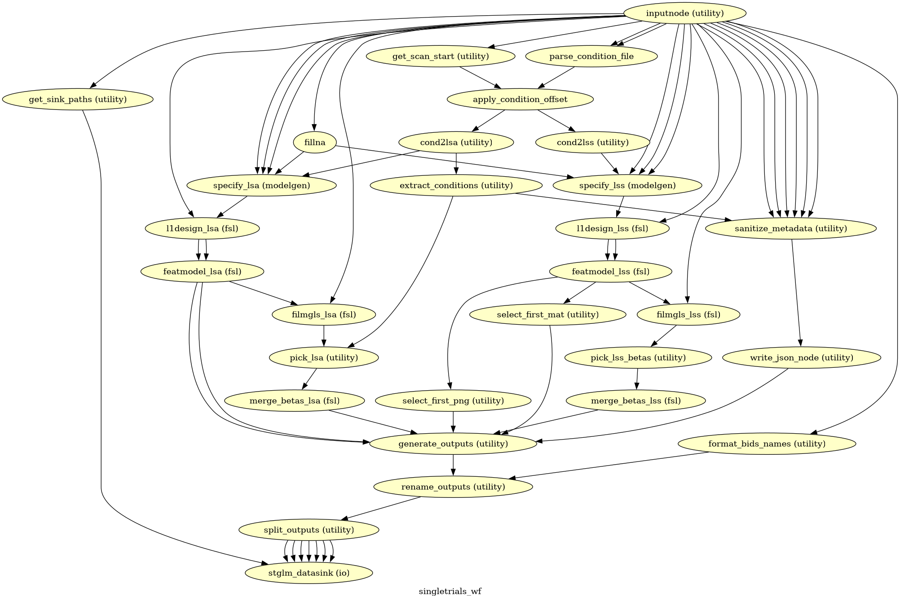

# stGLM

**stGLM** is a Python-based CLI tool and workflow engine designed to run single-trial GLMs (General Linear Models) on fMRI data using the BIDS standard. It supports LSA (Least Squares All) and LSS (Least Squares Separate) approaches to model trial-specific brain responses.



# Features
- Run-wise or Concatenated Analysis: Choose between per-run estimation or merged multi-run modeling.

- LSA and LSS Estimation: Compute trial-specific betas using flexible GLM estimation strategies.

- BIDS-Compatible: Fully supports input/output in BIDS format.

- Confound Selection: Extract nuisance regressors based on regex filtering of confound files (e.g., motion, aCompCor, ICA-AROMA).

- Design Matrix Visualization: Automatically generates design matrix plots for QA.

- Metadata Generation: Saves trial structure and modeling parameters as JSON.

# Installation

```bash
pip install git+https://github.com/gjheij/stglm
```

# Usage

```bash
job="stglm"

# or slurm:
sub=015
job="sbatch --partition=main --cpus-per-task=4 --job-name=sub-${sub}_desc-stglm --output=/mnt/d/fMRI/logs/stglm/HRA --export=ALL /home/gjheij/miniconda3/envs/fmriproc/bin/stglm"

${job} \
    --project-dir /path/to/bids_dataset \
    --subject ${sub} \
    --confound-subset "Motion acompcor" \
    --hrf dgamma_with_derivs \
    --lss-mode cond \
    --task HRA \
    --desc masked \
    --run-mode loop \
    --space T1w \
    --n-procs 4
```

## Required Arguments

| Argument        | Description                                                           |
| --------------- | --------------------------------------------------------------------- |
| `--project-dir` | Path to your BIDS dataset.                                            |
| `--subject`     | BIDS subject label (e.g., `"01"`).                                    |

## Optional arguments
| Argument             | Default                                    | Description                                                                                                                                           |
| -------------------- | ------------------------------------------ | ----------------------------------------------------------------------------------------------------------------------------------------------------- |
| `--evs`              | Event/trial names to model (e.g., `CS-`, `CS+_noUCS`, `CS+_withUCS`). | Filter out specific events; default is to include all available events
| `--deriv-dir`        | `<project-dir>/stglm` (or `../glmsingle`)  | Output directory. Defaults to `<project-dir>/stglm`, or `<project-dir>/glmsingle` if `--glm-single` is used.                                          |
| `--confounds-subset` | `"Motion acompcor"`                        | Nuisance regressors to include (subset names follow HALFpipe terminology).                                                                            |
| `--hrf`              | `dgamma`                                   | HRF basis: `dgamma`, `dgamma_with_derivs`, or `flobs`.                                                                                                |
| `--lss-mode`         | `cond`                                     | Mode for LSS estimation: `cond` or `nuis`.                                                                                                            |
| `--task`             | `HRA`                                      | Task label (e.g., `rest`, `HRA`).                                                                                                                     |
| `--desc`             | `masked`                                   | BOLD file description: `preproc` (from fMRIprep), `masked` (skull-stripped via `call_fprepmask`), or `pybest` (full Pybest output).                   |
| `--space`            | `T1w`                                      | Spatial normalization space (e.g., `T1w`, `MNI152NLin2009cAsym`, or `func` for native BOLD space).                                                    |
| `--run-mode`         | `loop`                                     | Choose `loop` (per-run estimation) or `concat` (merge runs; can affect noise/scaling).                                                                |
| `--workdir`          | `/tmp`                                     | Working directory for intermediate files.                                                                                                             |
| `--n-procs`          | `1`                                        | Number of CPU processes to use.                                                                                                                       |
| `--config`           | `None`                                     | Path to a JSON file with GLMsingle options.                                                                                                           |
| `--no-confounds`     | `False`                                    | Disable all confounds (useful if data are already denoised or when using `--glm-single`, which incorporates GLMdenoise internally).                   |
| `--glm-single`       | `False`                                    | Run GLMsingle instead of standard LSA/LSS (implements GLMdenoise, HRF optimization, beta regularization). Requires multiple runs and repeated events. |
| `--stim-duration`    | `0`                                        | Stimulus duration for GLMsingle (float, seconds).                                                                                                     |

## Outputs

Outputs are saved in:

```bash
<deriv-dir>/sub-<ID>/[ses-<ID>/]func/
```

Like so:

```bash
derivatives/stglm/sub-015/
└── ses-1
    └── func
        └── task-HRA
            ├── sub-015_ses-1_task-HRA_run-1_space-T1w_feature-LSA_condition-CSm_mask.nii.gz
            ├── sub-015_ses-1_task-HRA_run-1_space-T1w_feature-LSA_condition-CSm_stat-effect_statmap.json
            ├── sub-015_ses-1_task-HRA_run-1_space-T1w_feature-LSA_condition-CSm_stat-effect_statmap.nii.gz
            ├── sub-015_ses-1_task-HRA_run-1_space-T1w_feature-LSA_condition-CSpr_mask.nii.gz
            ├── sub-015_ses-1_task-HRA_run-1_space-T1w_feature-LSA_condition-CSpr_stat-effect_statmap.json
            ├── sub-015_ses-1_task-HRA_run-1_space-T1w_feature-LSA_condition-CSpr_stat-effect_statmap.nii.gz
            ├── sub-015_ses-1_task-HRA_run-1_space-T1w_feature-LSA_condition-CSpu_mask.nii.gz
            ├── sub-015_ses-1_task-HRA_run-1_space-T1w_feature-LSA_condition-CSpu_stat-effect_statmap.json
            ├── sub-015_ses-1_task-HRA_run-1_space-T1w_feature-LSA_condition-CSpu_stat-effect_statmap.nii.gz
            ├── sub-015_ses-1_task-HRA_run-1_space-T1w_feature-LSA_condition-USm_mask.nii.gz
            ├── sub-015_ses-1_task-HRA_run-1_space-T1w_feature-LSA_condition-USm_stat-effect_statmap.json
            ├── sub-015_ses-1_task-HRA_run-1_space-T1w_feature-LSA_condition-USm_stat-effect_statmap.nii.gz
            ├── sub-015_ses-1_task-HRA_run-1_space-T1w_feature-LSA_condition-USo_mask.nii.gz
            ├── sub-015_ses-1_task-HRA_run-1_space-T1w_feature-LSA_condition-USo_stat-effect_statmap.json
            ├── sub-015_ses-1_task-HRA_run-1_space-T1w_feature-LSA_condition-USo_stat-effect_statmap.nii.gz
            ├── sub-015_ses-1_task-HRA_run-1_space-T1w_feature-LSA_condition-USp_mask.nii.gz
            ├── sub-015_ses-1_task-HRA_run-1_space-T1w_feature-LSA_condition-USp_stat-effect_statmap.json
            ├── sub-015_ses-1_task-HRA_run-1_space-T1w_feature-LSA_condition-USp_stat-effect_statmap.nii.gz
            ├── sub-015_ses-1_task-HRA_run-1_space-T1w_feature-LSA_desc-design_matrix.mat
            ├── sub-015_ses-1_task-HRA_run-1_space-T1w_feature-LSA_desc-design_matrix.png
            ├── sub-015_ses-1_task-HRA_run-1_space-T1w_feature-LSS_condition-CSm_mask.nii.gz
            ├── sub-015_ses-1_task-HRA_run-1_space-T1w_feature-LSS_condition-CSm_stat-effect_statmap.json
            ├── sub-015_ses-1_task-HRA_run-1_space-T1w_feature-LSS_condition-CSm_stat-effect_statmap.nii.gz
            ├── sub-015_ses-1_task-HRA_run-1_space-T1w_feature-LSS_condition-CSpr_mask.nii.gz
            ├── sub-015_ses-1_task-HRA_run-1_space-T1w_feature-LSS_condition-CSpr_stat-effect_statmap.json
            ├── sub-015_ses-1_task-HRA_run-1_space-T1w_feature-LSS_condition-CSpr_stat-effect_statmap.nii.gz
            ├── sub-015_ses-1_task-HRA_run-1_space-T1w_feature-LSS_condition-CSpu_mask.nii.gz
            ├── sub-015_ses-1_task-HRA_run-1_space-T1w_feature-LSS_condition-CSpu_stat-effect_statmap.json
            ├── sub-015_ses-1_task-HRA_run-1_space-T1w_feature-LSS_condition-CSpu_stat-effect_statmap.nii.gz
            ├── sub-015_ses-1_task-HRA_run-1_space-T1w_feature-LSS_condition-USm_mask.nii.gz
            ├── sub-015_ses-1_task-HRA_run-1_space-T1w_feature-LSS_condition-USm_stat-effect_statmap.json
            ├── sub-015_ses-1_task-HRA_run-1_space-T1w_feature-LSS_condition-USm_stat-effect_statmap.nii.gz
            ├── sub-015_ses-1_task-HRA_run-1_space-T1w_feature-LSS_condition-USo_mask.nii.gz
            ├── sub-015_ses-1_task-HRA_run-1_space-T1w_feature-LSS_condition-USo_stat-effect_statmap.json
            ├── sub-015_ses-1_task-HRA_run-1_space-T1w_feature-LSS_condition-USo_stat-effect_statmap.nii.gz
            ├── sub-015_ses-1_task-HRA_run-1_space-T1w_feature-LSS_condition-USp_mask.nii.gz
            ├── sub-015_ses-1_task-HRA_run-1_space-T1w_feature-LSS_condition-USp_stat-effect_statmap.json
            ├── sub-015_ses-1_task-HRA_run-1_space-T1w_feature-LSS_condition-USp_stat-effect_statmap.nii.gz
            ├── sub-015_ses-1_task-HRA_run-1_space-T1w_feature-LSS_desc-design_matrix.mat
            ├── sub-015_ses-1_task-HRA_run-1_space-T1w_feature-LSS_desc-design_matrix.png
            ...
            ├── sub-015_ses-1_task-HRA_run-4_space-T1w_feature-LSS_desc-design_matrix.mat
            └── sub-015_ses-1_task-HRA_run-4_space-T1w_feature-LSS_desc-design_matrix.png
```

For each run or subject, you'll get:

- `*feature-LSA-condition-{}_stat-effect_statmap.nii.gz`: Beta images from LSA.
- `*feature-LSS-condition-{}_stat-effect_statmap.nii.gz`: Beta images from LSS.
- `*.json`: Metadata about model configuration and trial definitions.

## Confound Subset Options
Choose from the following predefined options (regex matched following `HALFpipe`'s convention):

```python
confound_options = {
    "ICA-AROMA": "ICA-AROMA",
    "Motion parameters": "(trans|rot)_[xyz]",
    "Derivatives of motion parameters": "(trans|rot)_[xyz]_derivative1",
    "Motion parameters squared": "(trans|rot)_[xyz]_power2",
    "Derivatives of motion parameters squared": "(trans|rot)_[xyz]_derivative1_power2",
    "Motion scrubbing": "motion_outlier[0-9]+",
    "aCompCor (top five components)": "c_comp_cor_0[0-4]",
    "White matter signal": "white_matter",
    "CSF signal": "csf",
    "Global signal": "global_signal",
}
```
